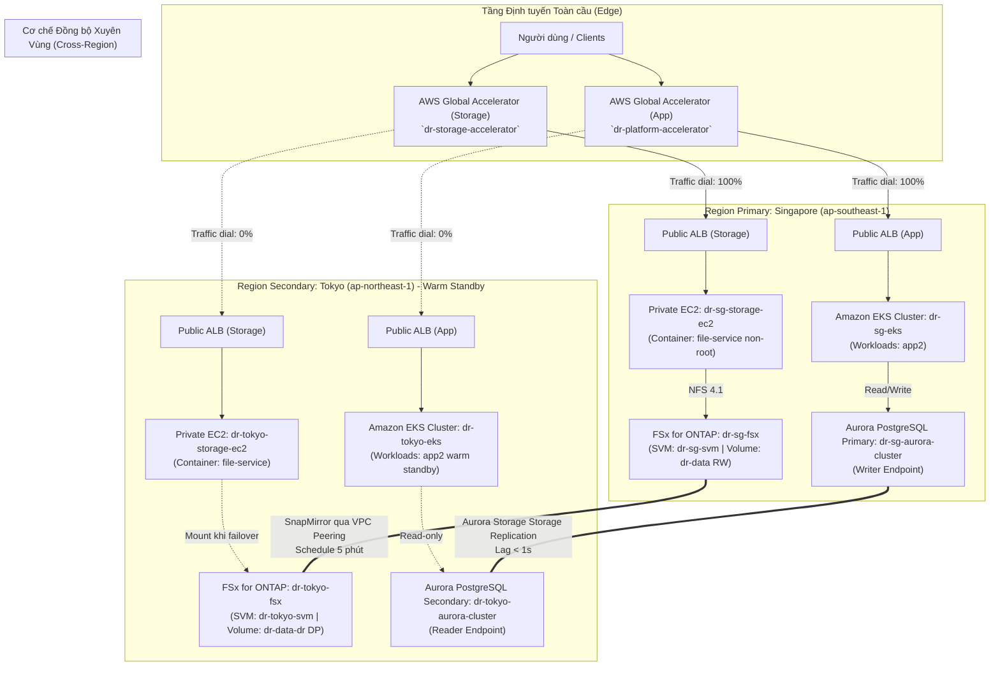

# Tổng quan Kiến trúc (Architecture Overview)

## 1. Giai đoạn Triển khai Hiện tại (Lab Phase)

Các bài lab cốt lõi xây dựng hạ tầng cơ sở dữ liệu và ứng dụng; các bài lab lưu trữ bổ sung luồng khắc phục thảm họa (DR) độc lập cho hệ thống tệp tin:

```text
ECR -> VPC -> EKS -> Controllers -> Aurora Global Database
    -> Secrets/ESO tiền đề -> Nền tảng GitOps Argo CD
    -> ALBs kiểm thử tạm thời -> Global Accelerator -> CloudWatch

EC2 -> NFS 4.1 -> FSx for ONTAP Singapore
    -> Đồng bộ bất đồng bộ SnapMirror -> FSx for ONTAP Tokyo
```

Thư mục `gitops/app2` là ranh giới phân phối cho EKS. Dịch vụ `file-service` chạy trên máy ảo EC2 private và không do Argo CD quản lý trực tiếp.

## 2. Kiến trúc Mục tiêu (Target Architecture)



## 3. Nền tảng Tài nguyên Vùng (Regional Foundations)

| Tầng Hạ tầng | Singapore (Primary) | Tokyo (Secondary / Warm Standby) |
|---|---|---|
| **Region** | `ap-southeast-1` | `ap-northeast-1` |
| **VPC** | `dr-sg-vpc` (`10.10.0.0/16`) | `dr-tokyo-vpc` (`10.20.0.0/16`) |
| **EKS Cluster** | `dr-sg-eks` | `dr-tokyo-eks` |
| **Node Group** | `dr-sg-ng` | `dr-tokyo-ng` |
| **Aurora Cluster** | `dr-sg-aurora-cluster` (Writer) | `dr-tokyo-aurora-cluster` (Reader) |
| **ALB Kiểm thử** | `dr-sg-validation-alb` | `dr-tokyo-validation-alb` |
| **Storage EC2** | `dr-sg-storage-ec2` | `dr-tokyo-storage-ec2` |
| **Storage ALB** | `dr-sg-storage-alb` | `dr-tokyo-storage-alb` |
| **FSx / SVM / Volume** | `dr-sg-fsx` / `dr-sg-svm` / `dr-data` (RW) | `dr-tokyo-fsx` / `dr-tokyo-svm` / `dr-data-dr` (DP) |

## 4. Mô hình Dự phòng Nóng (Warm Standby Model)

- **Singapore:** Tiếp nhận toàn bộ lưu lượng người dùng thông thường và thực hiện mọi giao dịch ghi cơ sở dữ liệu / tệp tin.
- **Tokyo:** Giữ hạ tầng luôn trực tuyến (healthy), nhận container image đã replicate từ ECR, storage cơ sở dữ liệu đã replicate từ Aurora, bản sao secret từ Secrets Manager, controller nền tảng và các endpoint kiểm tra sức khỏe.
- **Global Accelerator:** Định tuyến dựa trên tình trạng sức khỏe (Health checks) của Endpoint Group và điều chuyển lưu lượng cho các kết nối mới (New connections).
- **Aurora Global Database:**
  - *Managed Switchover:* Dùng cho việc chuyển vai trò có kế hoạch (Planned), không mất dữ liệu.
  - *Managed Failover:* Dùng khi xảy ra thảm họa đột ngột (Unplanned), chấp nhận mất mát dữ liệu chưa kịp đồng bộ (unreplicated data).

## 5. Ranh giới Khả dụng và Chống Chịu Sự cố

- **Tính sẵn sàng cao trong vùng (Multi-AZ):** Mỗi Region sử dụng 2 Availability Zones cho Subnets, ALB, phân bổ EKS Nodes và DB Subnet Groups.
- **NAT Gateway:** Chế độ lab sử dụng 1 NAT Gateway cho mỗi Region để tiết kiệm chi phí. Môi trường Production thực tế cần 1 NAT Gateway trên mỗi AZ.
- **Cơ sở dữ liệu Aurora:** Lab triển khai 1 instance cho mỗi Region để tiết kiệm ngân sách. Production yêu cầu tối thiểu 1 Reader nội bộ trong cùng Region để tự động failover AZ.
- **VPC Peering xuyên vùng:** Cần thiết cho SnapMirror truyền dữ liệu giữa các intercluster LIFs của NetApp ONTAP. Dịch vụ Aurora, ECR và Secrets Manager sử dụng mạng trục backbone riêng của AWS mà không phụ thuộc vào VPC Peering này.

## 6. Ranh giới Bảo mật (Security Boundaries)

- Các EKS worker nodes, RDS Aurora instances và FSx ONTAP endpoints đều nằm trong **Private Subnets**, hoàn toàn không có Public IP.
- Quyền truy cập vào EKS của con người sử dụng **IAM Access Entries** và temporary credentials.
- Các Controller (như AWS Load Balancer Controller) sử dụng **IRSA (IAM Roles for Service Accounts)** với Trust Policy khóa cứng ServiceAccount tương ứng; Worker Node Role chỉ giữ quyền tối thiểu.
- Toàn bộ secret của ứng dụng được quản lý tập trung và mã hóa trong **AWS Secrets Manager**, truy xuất qua External Secrets Operator (ESO).

## 7. Mục tiêu Khôi phục Thảm họa (Recovery Objectives)

| Chỉ số Mục tiêu | Giá trị Thiết kế (Target) | Trạng thái Chứng minh Thực tế |
|---|---:|---|
| **RTO Hạ tầng Mạng** | `< 5 phút` | Đo lường thực nghiệm trong LAB 14 & 15 |
| **RPO Cơ sở dữ liệu (Aurora)** | `< 30 giây` | Quan sát qua metric CloudWatch `ReplicationLag` |
| **RTO Ứng dụng Toàn diện** | `< 15 phút` | Đo lường trong LAB 26 (Unified DR Test) |
| **RPO Lưu trữ Tệp tin (Storage RPO)** | `< 5 phút` | Đo lường bằng độ lệch marker chuỗi ghi thực tế |
| **RTO Lưu trữ Tệp tin (Storage RTO)** | `< 15 phút` | Đo từ lúc khai báo sự cố đến khi Tokyo nhận write đầu tiên |

*Lưu ý: Các giá trị mục tiêu (Design target) cần được phân biệt rõ với kết quả đo đạc thực tế sau diễn tập (Measured Result).*

## 8. Lộ trình Triển khai (Roadmap)

1. **Giai đoạn 1 (Phase 1):** Triển khai toàn bộ hạ tầng bằng AWS Console click-by-click và kiểm thử readiness.
2. **Giai đoạn 2 (Phase 2):** Xây dựng CI/CD cho `app2`, tạo container image bất biến, quản lý cấu hình bằng GitOps Argo CD.
3. **Giai đoạn 3 (Phase 3):** Diễn tập thảm họa với các giao dịch kinh doanh thật, đo lường chính xác RTO và RPO nghiệp vụ.
4. **Giai đoạn 4 (Phase 4):** Tự động hóa hạ tầng bằng Terraform / IaC dựa trên kiến trúc đã được kiểm chứng chuẩn xác.
