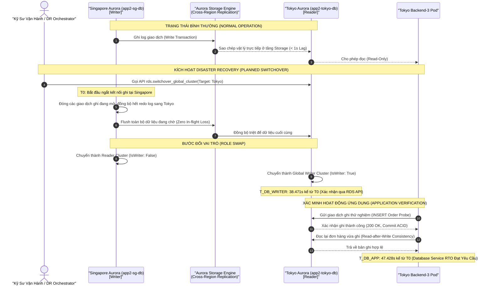

# Sơ Đồ Cơ Chế Aurora Global Database Replication & DR

Tài liệu này mô tả chi tiết cơ chế nhân bản dữ liệu và quy trình chuyển đổi vai trò (Switchover/Failover) của **Amazon Aurora Global Database (PostgreSQL)** giữa Singapore và Tokyo.

---

## Điểm Khác Biệt Giữa Planned Switchover và Unplanned Failover

| Đặc Điểm | Planned Switchover (Đã Thực Nghiệm) | Unplanned Failover (Kịch Bản Khẩn Cấp) |
|---|---|---|
| **Mục đích** | Bảo trì định kỳ, diễn tập DR có kế hoạch | Vùng chính gặp sự cố thảm họa vật lý mất điện/mạng hoàn toàn |
| **Bảo toàn dữ liệu** | **Không mất mát (Zero Data Loss)**: Chờ đồng bộ hết buffer | Có thể mất một khoảng dữ liệu nhỏ tương ứng với lag time (< 1s) |
| **Cụm ban đầu** | Tự động chuyển thành Reader Cluster để tiếp tục nhân bản ngược | Bị cô lập (Fenced); cần thao tác xóa hoặc tái tích hợp sau sự cố |
| **Lệnh AWS API** | `rds:SwitchoverGlobalCluster` | `rds:FailoverGlobalCluster` |
