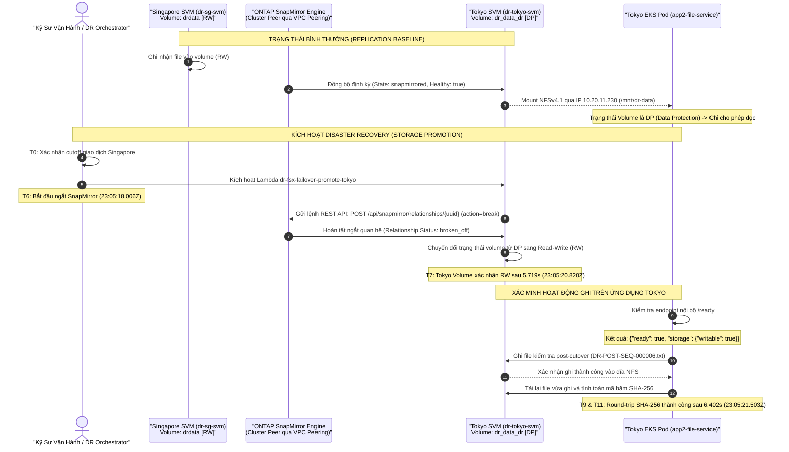

# Sơ Đồ Cơ Chế FSx ONTAP SnapMirror Replication & Promotion

Tài liệu này mô tả chi tiết cơ chế sao chép tệp tin đa vùng bằng **NetApp ONTAP SnapMirror** trên dịch vụ **Amazon FSx for NetApp ONTAP**, cùng quy trình kích hoạt chuyển đổi lưu trữ tệp tin (Storage Promotion).

---

## Chi Tiết Các Mốc Thời Gian (Storage Milestones)

- **$T_0$**: Thời điểm bắt đầu diễn tập cutover.
- **$T_6$ (`SNAPMIRROR_PROMOTION_STARTED`)**: Lambda function gọi ONTAP REST API để thực hiện thao tác `break-off` quan hệ SnapMirror.
- **$T_7$ (`T_VOL_RW`)**: Volume tại Tokyo hoàn tất chuyển trạng thái thành `RW` (Read-Write) trên hệ điều hành ONTAP.
- **$T_9$ (`T_SVC_VERIFY`)**: Dịch vụ `app2-file-service` tại Tokyo ghi file mới, đọc lại và xác thực mã băm SHA-256 trùng khớp 100%.
- **$T_{11}$ (`T_EXTERNAL`)**: Đầu cuối xác thực hoàn tất, dịch vụ lưu trữ sẵn sàng phục vụ toàn diện.
