# Sơ Đồ Quy Trình Thực Thi Unified DR (Unified DR Execution Flow)

Tài liệu này mô tả chi tiết quy trình thực thi có điều phối giữa nhánh Cơ sở dữ liệu và Lưu trữ tệp tin trong lần diễn tập thực tế (`LIVE-RUN-20261018-230436`).

```mermaid
flowchart TD
    Start(["BẮT ĐẦU DIỄN TẬP LIVE UNIFIED DR"]) --> Preflight["1. PREFLIGHT DISCOVERY & HEALTH CHECKS\n- Kiểm tra RDS Global Cluster status: available\n- Kiểm tra FSx ONTAP Volume & SnapMirror healthy: true\n- Kiểm tra Ingress & Application Pods ở 2 vùng: HTTP 200"]

    Preflight --> Gate{"Cổng Phê Duyệt An Toàn\n(Safety Gate Token)"}
    Gate -- "Không có phê duyệt" --> Abort["HỦY DIỄN TẬP AN TOÀN (No Mutation)"]
    Gate -- "Phê duyệt hợp lệ (--confirm-live-drill)" --> PreDrill["2. INJECT PRE-DRILL BASELINE MARKERS\n- Ghi 5 đơn hàng tuần tự vào Singapore DB (Seq 1-5)\n- Upload 5 tệp tin tuần tự vào Singapore FSx (Seq 1-5)\n- Gọi API SnapMirror update transfer & đợi đồng bộ"]

    PreDrill --> T0["3. T0 CUTOFF MỐC THỜI GIAN (23:05:15.101Z)\nNgắt traffic ghi tại Singapore"]

    T0 --> BranchParallel{"ĐIỀU PHỐI SONG SONG\n(Parallel Execution)"}

    %% DB Branch
    subgraph DB_Branch ["Nhánh Cơ Sở Dữ Liệu (Database Branch)"]
        DB_Action["Gọi rds.switchover_global_cluster\n(Target: Tokyo cluster)"] --> DB_Wait{"Chờ Tokyo Aurora\nchuyển thành Global Writer"}
        DB_Wait -->|IsWriter = True| DB_Milestone["Milestone T_DB_WRITER: 38.471s\n(23:05:53.572Z)"]
        DB_Milestone --> DB_Probe["Gửi giao dịch kiểm tra đơn hàng #133 qua Tokyo ALB"]
        DB_Probe --> DB_Verify["Xác thực Read-after-Write Transaction thành công"]
        DB_Verify --> DB_Done["Milestone T_DB_APP: 47.428s\n(23:06:02.529Z)"]
    end

    %% Storage Branch
    subgraph Storage_Branch ["Nhánh Lưu Trữ Tệp Tin (Storage Branch)"]
        St_Action["Trigger Lambda dr-fsx-failover-promote-tokyo\n(Gọi ONTAP API break SnapMirror)"] --> St_Wait{"Chờ Tokyo FSx\nVolume chuyển sang RW"}
        St_Wait -->|Type = RW| St_Milestone["Milestone T7: 5.719s\n(23:05:20.820Z)"]
        St_Milestone --> St_Probe["Gửi file kiểm tra #000006 qua Tokyo ALB"]
        St_Probe --> St_Verify["Tải file về và đối soát mã băm SHA-256"]
        St_Verify --> St_Done["Milestone T9 & T11: 6.402s\n(23:05:21.503Z)"]
    end

    BranchParallel --> DB_Branch
    BranchParallel --> Storage_Branch

    DB_Done --> Convergence{"Hội Tụ Hai Nhánh Phục Hồi\n(max(DB RTO, Storage RTO))"}
    St_Done --> Convergence

    Convergence --> FinalRTO["4. XÁC NHẬN OVERALL UNIFIED RTO: 47.429s\n(Target: <= 300.0s -> PASS)"]

    FinalRTO --> RPO_Audit["5. AUDIT DỮ LIỆU ĐỘC LẬP (RPO VERIFICATION)\n- Đối soát 5/5 đơn hàng trong Tokyo DB -> RPO: 0.0s (Lost: 0)\n- Đối soát 5/5 tệp tin trong Tokyo FSx -> RPO: 0.0s (Lost: 0, 100% SHA)"]

    RPO_Audit --> Finish(["HOÀN TẤT DIỄN TẬP & XUẤT EVIDENCE TỔNG HỢP"])
```

---

## Ghi Chú Về Bộ Điều Phối (DR Orchestration)

> [!NOTE]
> - Trong cuộc diễn tập thực tế này, việc điều phối được thực hiện thông qua **Python DR Orchestration Runner** gọi trực tiếp các AWS SDK API (`boto3`) và AWS Lambda function phụ trách lưu trữ.
> - Cấu trúc Step Functions State Machine cho Unified DR hiện được lưu trữ dưới dạng mẫu thiết kế Terraform (`unified_state_machine.asl.json.tftpl`) và chưa được triển khai live trên AWS.
