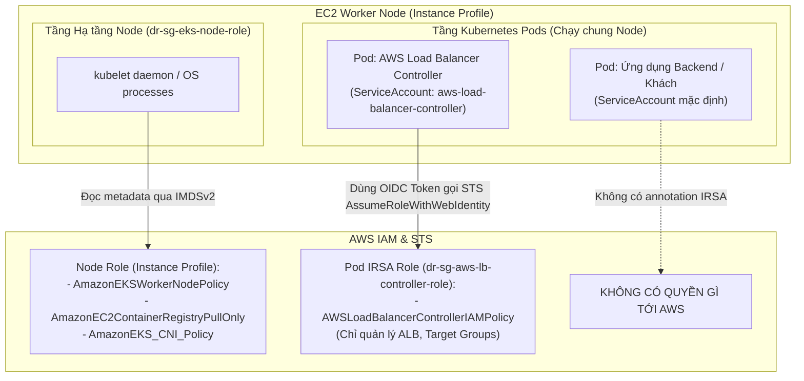

# LAB 07 - AWS Load Balancer Controller

## 1. Mục tiêu

Cài đặt AWS Load Balancer Controller độc lập trên hai EKS cluster bằng IRSA role riêng cho từng cluster và phiên bản Helm chart đã được rà soát.

## 2. Thành phần sẽ xây dựng

- IAM OIDC provider cho mỗi cluster.
- IAM policy đặc quyền tối thiểu dùng chung cho controller.
- IRSA role riêng `dr-sg-aws-lb-controller-role` và `dr-tokyo-aws-lb-controller-role`.
- Helm release `aws-load-balancer-controller` trong mỗi cluster.
- Chưa tạo Ingress/ALB cho tới LAB 11.

## 3. Bối cảnh kiến trúc và Cơ chế IRSA (IAM Roles for Service Accounts)

### 3.1 So sánh Kiến trúc: Node Instance Profile vs Pod IRSA

Trong kiến trúc bảo mật chuẩn của AWS EKS, việc phân tách đặc quyền tuân thủ nghiêm ngặt nguyên tắc **Least Privilege (Đặc quyền tối thiểu)**:



| Tiêu chí | Node IAM Role (qua EC2 Instance Profile) | Pod IAM Role (qua IRSA) |
|---|---|---|
| **Mục đích** | Phục vụ các tiến trình hệ điều hành của Worker Node (Kubelet join cluster, kéo image từ ECR, cấu hình CNI network). | Cấp quyền nghiệp vụ riêng biệt cho từng container/Pod trong Kubernetes. |
| **Gắn kết tài nguyên** | Gắn vào **EC2 Instance Profile** của EKS Managed Node Group (`dr-*-node-role`). | Gắn vào **Kubernetes ServiceAccount** qua annotation `eks.amazonaws.com/role-arn`. |
| **Cơ chế xác thực** | EC2 Instance Metadata Service (IMDSv2). | AWS STS `AssumeRoleWithWebIdentity` thông qua EKS OIDC Identity Provider. |
| **Phạm vi tác động** | Toàn bộ máy ảo EC2. Mọi tiến trình trên node đều có thể truy cập nếu không bị chặn. | Chỉ áp dụng cho Pod được chỉ định ServiceAccount đó. |
| **Nguy cơ nếu gán sai** | **NGUY HIỂM:** Nếu cấp quyền quản lý ALB, S3 hoặc Secrets Manager vào Node Role, thì **bất kỳ Pod nào** chạy trên node đó (kể cả pod untrusted) đều có thể lấy trộm quyền để thao túng hạ tầng! | **AN TOÀN:** Pod controller chỉ có quyền quản lý ALB; Pod ứng dụng chỉ có quyền đọc secret của chính nó; hoàn toàn không chồng chéo. |

---

### 3.2 Cơ chế hoạt động của IRSA (Bước-từng-bước)

1. **OIDC Federation:** EKS Cluster tự động cung cấp một OpenID Connect (OIDC) Issuer URL có chữ ký số. Ta đăng ký OIDC URL này làm một **IAM Identity Provider** trên AWS IAM.
2. **Khai báo Trust Policy:** Tạo IAM Role với `sts:AssumeRoleWithWebIdentity`, giới hạn điều kiện nghiêm ngặt:
   - `aud` (Audience): Bắt buộc là `sts.amazonaws.com`.
   - `sub` (Subject): Khóa chặt vào đúng ServiceAccount cụ thể (ví dụ: `system:serviceaccount:kube-system:aws-load-balancer-controller`).
3. **Projected Service Account Token:** Khi Pod khởi động với ServiceAccount đã được gắn annotation `eks.amazonaws.com/role-arn`, EKS Pod Identity Webhook sẽ tự động:
   - Mount một JSON Web Token (JWT) có chữ ký OIDC vào đường dẫn `/var/run/secrets/eks.amazonaws.com/serviceaccount/token`.
   - Tiêm hai biến môi trường vào container:
     - `AWS_ROLE_ARN`: ARN của IAM Role tương ứng.
     - `AWS_WEB_IDENTITY_TOKEN_FILE`: Đường dẫn tới file token trên.
4. **Đổi Token lấy Credential:** AWS SDK bên trong Pod tự động đọc file token và gọi API `sts:AssumeRoleWithWebIdentity`. AWS STS xác thực chữ ký token với EKS OIDC Provider, kiểm tra Trust Policy và trả về bộ temporary credentials (`AccessKeyId`, `SecretAccessKey`, `SessionToken`) để Pod thao tác với AWS APIs.
5. **Độc lập Multi-Region:** Do mỗi cluster EKS tại Singapore (`dr-sg-eks`) và Tokyo (`dr-tokyo-eks`) sở hữu một OIDC Issuer ID riêng biệt, nên Trust Policy của từng Region phải được cấu hình độc lập, không dùng chung ID.

## 4. Điều kiện tiên quyết

- Hoàn thành LAB 05-06; Tokyo đang ở chế độ kiểm thử hai node.
- Public subnet có tag `kubernetes.io/role/elb=1`.
- Có sẵn `helm`, `kubectl`, `curl` và AWS CLI.
- Rà trang cài đặt controller chính thức hiện hành của AWS EKS; chọn `<GATEWAY_API_VERSION>`, `<LBC_APP_VERSION>` và `<LBC_CHART_VERSION>` tương thích. Tại ngày rà tài liệu, AWS liệt kê Gateway API CRD là điều kiện tiên quyết; không bỏ qua yêu cầu hiện hành chỉ vì lab dùng Ingress.

## 5. Quy ước đặt tên tài nguyên

| Hạng mục | Giá trị |
|---|---|
| IAM policy | `AWSLoadBalancerControllerIAMPolicy` |
| SG role | `dr-sg-aws-lb-controller-role` |
| Tokyo role | `dr-tokyo-aws-lb-controller-role` |
| ServiceAccount | `kube-system/aws-load-balancer-controller` |
| Helm release | `aws-load-balancer-controller` |

## 6. Các bước triển khai

### 6.1 Lấy OIDC Issuer URL từ EKS Console

Bạn có thể lấy OIDC Issuer URL thông qua giao diện EKS Console hoặc AWS CLI:

- **Trên EKS Console:**
  1. Vào EKS Console tại Singapore (`ap-southeast-1`) -> chọn cluster `dr-sg-eks`.
  2. Tại tab **Overview**, cuộn xuống mục **Details** -> tìm trường **OpenID Connect provider URL** (dạng `https://oidc.eks.ap-southeast-1.amazonaws.com/id/EXXXXXXXXXXXXXXXXXXXXXXXXXXXXXXXX`).
  3. Sao chép (copy) đường dẫn này.
  4. Lặp lại thao tác tương tự tại Tokyo (`ap-northeast-1`) cho cluster `dr-tokyo-eks`.
- **Hoặc qua AWS CLI:**

```bash
aws eks describe-cluster --region ap-southeast-1 --name dr-sg-eks \
  --query 'cluster.identity.oidc.issuer' --output text
aws eks describe-cluster --region ap-northeast-1 --name dr-tokyo-eks \
  --query 'cluster.identity.oidc.issuer' --output text
```

### 6.2 Tạo IAM Identity Provider (OIDC) cho cả 2 Cluster

Thực hiện liên kết OIDC Provider trong IAM để EKS có thể sử dụng cơ chế IAM Roles for Service Accounts (IRSA):

1. Mở AWS Console, chuyển đến dịch vụ **IAM**.
2. Trong thanh menu bên trái, nhấp chọn **Identity providers**.
3. *Tạo Provider cho Singapore:*
   - Nhấp nút **Add provider** màu cam ở góc trên bên phải.
   - **Provider type**: Chọn **OpenID Connect**.
   - **Provider URL**: Dán chính xác OpenID Connect provider URL của `dr-sg-eks` (ví dụ: `https://oidc.eks.ap-southeast-1.amazonaws.com/id/...`).
   - **Audience**: Nhập `sts.amazonaws.com`.
   - Nhấp nút **Add provider** màu cam.
4. *Tạo Provider cho Tokyo:*
   - Tiếp tục nhấp nút **Add provider**.
   - **Provider type**: Chọn **OpenID Connect**.
   - **Provider URL**: Dán chính xác OpenID Connect provider URL của `dr-tokyo-eks`.
   - **Audience**: Nhập `sts.amazonaws.com`.
   - Nhấp nút **Add provider**.

### 6.3 Tạo IAM Policy chính thức cho AWS Load Balancer Controller

1. Tải policy JSON chính thức từ GitHub repository của AWS Load Balancer Controller:

```bash
# Thay thế <LBC_APP_VERSION> bằng phiên bản controller tương ứng (ví dụ: v2.8.2)
curl -o iam_policy.json \
  https://raw.githubusercontent.com/kubernetes-sigs/aws-load-balancer-controller/main/docs/install/iam_policy.json
```

2. Tạo Policy trên IAM Console:
   - Trong menu bên trái của IAM Console, nhấp chọn **Policies**.
   - Nhấp nút **Create policy** màu cam.
   - Tại trình soạn thảo Policy editor, chuyển sang tab **JSON**.
   - Xóa toàn bộ nội dung mẫu và dán toàn bộ nội dung file `iam_policy.json` vừa tải về.
   - Nhấp nút **Next** ở cuối trang.
   - **Policy name**: Nhập `AWSLoadBalancerControllerIAMPolicy`.
   - **Description**: Nhập `Permissions for AWS Load Balancer Controller to manage ALBs and Target Groups`.
   - Nhấp nút **Create policy** màu cam.

> [!CAUTION]
> Tuyệt đối không gắn `AdministratorAccess` cho Controller ServiceAccount. Chỉ sử dụng đúng tập quyền hạn đã được quy định trong chính sách chính thức.

### 6.4 Tạo IAM Role (IRSA) cho Controller tại Singapore và Tokyo

#### Bước 1: Tạo Role cho Singapore (`dr-sg-aws-lb-controller-role`)
1. Trong IAM Console, chọn **Roles** -> nhấp **Create role**.
2. **Select trusted entity**:
   - Chọn **Web identity**.
   - **Identity provider**: Trong danh sách dropdown, chọn OIDC Provider tương ứng của cluster `dr-sg-eks` (chứa mã ID của Singapore).
   - **Audience**: Chọn `sts.amazonaws.com`.
   - Nhấp nút **Next**.
3. **Add permissions**:
   - Tìm kiếm và tích chọn policy `AWSLoadBalancerControllerIAMPolicy` vừa tạo ở bước 6.3.
   - Nhấp nút **Next**.
4. **Name, review, and create**:
   - **Role name**: Nhập `dr-sg-aws-lb-controller-role`.
   - Nhấp **Create role**.
5. *Rà soát và tinh chỉnh Trust Policy:*
   - Tìm và nhấp vào role `dr-sg-aws-lb-controller-role` vừa tạo -> chuyển sang tab **Trust relationships** -> nhấp **Edit trust policy**.
   - Đảm bảo điều kiện `StringEquals` có cấu trúc giới hạn chính xác ServiceAccount:

```json
{
  "Version": "2012-10-17",
  "Statement": [
    {
      "Effect": "Allow",
      "Principal": {
        "Federated": "arn:aws:iam::<ACCOUNT_ID>:oidc-provider/oidc.eks.ap-southeast-1.amazonaws.com/id/<SG_OIDC_ID>"
      },
      "Action": "sts:AssumeRoleWithWebIdentity",
      "Condition": {
        "StringEquals": {
          "oidc.eks.ap-southeast-1.amazonaws.com/id/<SG_OIDC_ID>:aud": "sts.amazonaws.com",
          "oidc.eks.ap-southeast-1.amazonaws.com/id/<SG_OIDC_ID>:sub": "system:serviceaccount:kube-system:aws-load-balancer-controller"
        }
      }
    }
  ]
}
```

   - Nhấp **Update policy**.

#### Bước 2: Tạo Role cho Tokyo (`dr-tokyo-aws-lb-controller-role`)
1. Lặp lại tương tự: Chọn **Create role** -> **Web identity** -> Chọn OIDC Provider của `dr-tokyo-eks` -> Audience: `sts.amazonaws.com`.
2. Gắn policy: `AWSLoadBalancerControllerIAMPolicy`.
3. Đặt Role name: `dr-tokyo-aws-lb-controller-role`.
4. Cập nhật Trust relationship trỏ đúng vào `<TOKYO_OIDC_ID>` và ServiceAccount `system:serviceaccount:kube-system:aws-load-balancer-controller`.

### 6.5 Tạo ServiceAccount có annotation

```bash
kubectl --context singapore -n kube-system create serviceaccount aws-load-balancer-controller
kubectl --context singapore -n kube-system annotate serviceaccount aws-load-balancer-controller \
  eks.amazonaws.com/role-arn=arn:aws:iam::<ACCOUNT_ID>:role/dr-sg-aws-lb-controller-role

kubectl --context tokyo -n kube-system create serviceaccount aws-load-balancer-controller
kubectl --context tokyo -n kube-system annotate serviceaccount aws-load-balancer-controller \
  eks.amazonaws.com/role-arn=arn:aws:iam::<ACCOUNT_ID>:role/dr-tokyo-aws-lb-controller-role
```

Nếu ServiceAccount đã tồn tại, kiểm tra quyền sở hữu rồi dùng `annotate --overwrite`.

### 6.6 Cài Gateway API CRD

Dùng bản phát hành Gateway API chính thức đã rà soát trên cả hai cluster:

```bash
kubectl --context singapore apply --server-side \
  -f https://github.com/kubernetes-sigs/gateway-api/releases/download/<GATEWAY_API_VERSION>/standard-install.yaml
kubectl --context tokyo apply --server-side \
  -f https://github.com/kubernetes-sigs/gateway-api/releases/download/<GATEWAY_API_VERSION>/standard-install.yaml
```

### 6.7 Cài đặt bằng Helm

```bash
helm repo add eks https://aws.github.io/eks-charts
helm repo update eks
helm search repo eks/aws-load-balancer-controller --versions | head
```

```bash
helm upgrade --install aws-load-balancer-controller eks/aws-load-balancer-controller \
  --kube-context singapore -n kube-system \
  --version <LBC_CHART_VERSION> \
  --set clusterName=dr-sg-eks \
  --set serviceAccount.create=false \
  --set serviceAccount.name=aws-load-balancer-controller \
  --set region=ap-southeast-1 \
  --set vpcId=<SG_VPC_ID> \
  --wait --timeout 10m

helm upgrade --install aws-load-balancer-controller eks/aws-load-balancer-controller \
  --kube-context tokyo -n kube-system \
  --version <LBC_CHART_VERSION> \
  --set clusterName=dr-tokyo-eks \
  --set serviceAccount.create=false \
  --set serviceAccount.name=aws-load-balancer-controller \
  --set region=ap-northeast-1 \
  --set vpcId=<TOKYO_VPC_ID> \
  --wait --timeout 10m
```

## 7. Xác minh Hoạt động và Cơ chế IRSA

### 7.1 Kiểm tra Deployment và ServiceAccount

```bash
# Kiểm tra trạng thái Pods của Controller
kubectl --context singapore -n kube-system get deployment aws-load-balancer-controller
kubectl --context tokyo -n kube-system get deployment aws-load-balancer-controller

# Kiểm tra annotation IRSA trên ServiceAccount
kubectl --context singapore -n kube-system get serviceaccount aws-load-balancer-controller -o yaml
kubectl --context tokyo -n kube-system get serviceaccount aws-load-balancer-controller -o yaml
```

*Kỳ vọng:* ServiceAccount chứa đúng annotation `eks.amazonaws.com/role-arn: arn:aws:iam::<ACCOUNT_ID>:role/dr-*-aws-lb-controller-role`.

### 7.2 Xác minh Projected Token và Biến Môi trường IRSA trên Pod

Kiểm tra xem EKS Pod Identity Webhook đã tự động tiêm biến môi trường và mount volume token OIDC vào Pod của Controller chưa:

```bash
# Xem các biến môi trường AWS trong Pod tại Singapore
kubectl --context singapore -n kube-system exec -it deploy/aws-load-balancer-controller -- env | grep -E "AWS_ROLE_ARN|AWS_WEB_IDENTITY_TOKEN_FILE"

# Xem các biến môi trường AWS trong Pod tại Tokyo
kubectl --context tokyo -n kube-system exec -it deploy/aws-load-balancer-controller -- env | grep -E "AWS_ROLE_ARN|AWS_WEB_IDENTITY_TOKEN_FILE"
```

*Kỳ vọng kết quả:*
```text
AWS_ROLE_ARN=arn:aws:iam::<ACCOUNT_ID>:role/dr-sg-aws-lb-controller-role
AWS_WEB_IDENTITY_TOKEN_FILE=/var/run/secrets/eks.amazonaws.com/serviceaccount/token
```

### 7.3 Kiểm tra Log Khởi động và Quyền IAM của Controller

```bash
# Kiểm tra log controller tại Singapore
kubectl --context singapore -n kube-system logs -l app.kubernetes.io/name=aws-load-balancer-controller --tail=50

# Kiểm tra log controller tại Tokyo
kubectl --context tokyo -n kube-system logs -l app.kubernetes.io/name=aws-load-balancer-controller --tail=50
```

*Kỳ vọng:* Log hiển thị controller đã khởi động thành công, lắng nghe Ingress/TargetGroupBinding events và **không** xuất hiện các lỗi liên quan đến:
- `WebIdentityErr`: Lỗi JWT token hoặc OIDC provider không khớp.
- `AccessDeniedException`: Lỗi thiếu quyền IAM policy.

## 8. Kết quả mong đợi

Cả hai controller khỏe mạnh và dùng IRSA role đặc quyền tối thiểu riêng. Chưa có application Ingress.

## 9. Xử lý sự cố

- `WebIdentityErr`: OIDC provider, audience, subject hoặc role annotation không khớp.
- `AccessDenied`: so sánh IAM policy đã cài với tài liệu của đúng controller release.
- Không tìm thấy subnet ở bước sau: kiểm tra role tag của public/private subnet.
- Lỗi Helm CRD khi nâng cấp: Helm không phải lúc nào cũng cập nhật CRD; làm theo ghi chú nâng cấp chính thức của release.

## 10. Lưu ý bảo mật

- Trust policy phải chứa chính xác subject của ServiceAccount.
- Mỗi cluster dùng role riêng; có thể dùng chung policy.
- Rà diff của policy trước khi nâng cấp controller.
- CloudTrail nên ghi nhận thay đổi ELB/EC2 được thực hiện qua role.

## 11. Lưu ý chi phí

Pod controller dùng node hiện có. Chi phí ALB chỉ bắt đầu khi LAB 11 tạo tài nguyên Ingress.

## 12. Dọn dẹp / Quay lui

Gỡ Helm release, xóa ServiceAccount, sau đó chỉ gỡ role/OIDC provider khi không còn workload IRSA nào sử dụng chúng.

## 13. Bằng chứng cần thu thập

Phiên bản ứng dụng/chart của controller, source tag của IAM policy, OIDC issuer, điều kiện trust, annotation ServiceAccount và trạng thái sẵn sàng của deployment.

## 14. Lab tiếp theo

Tiếp tục với [LAB 08 - Aurora PostgreSQL Global Database](08-aurora-global-database.md).
